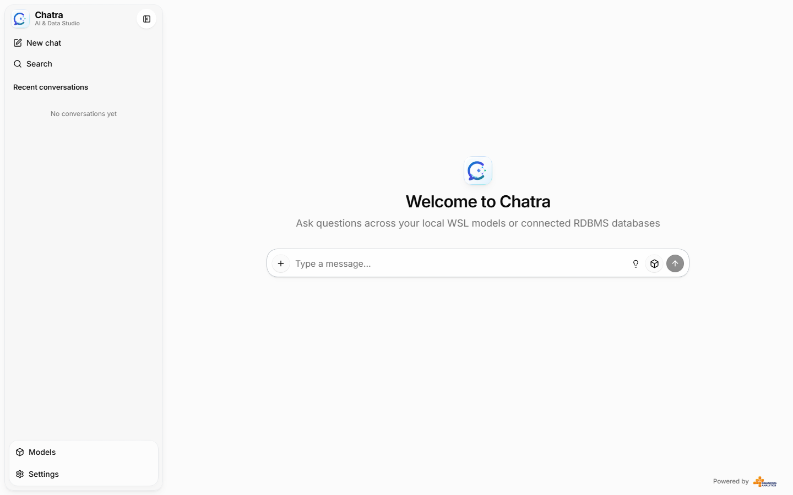
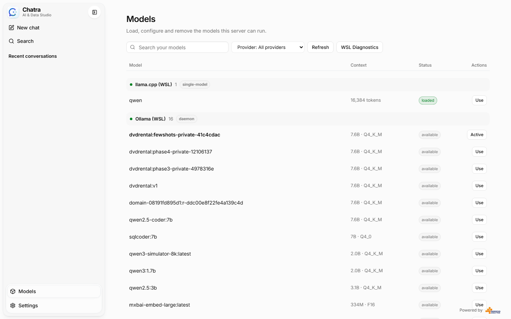

<p align="center">
  
</p>

<h1 align="center">Chatra — Local AI Chat &amp; Database Analytics Studio</h1>

<p align="center">
  <strong>Private, local-first AI Chat UI, RDBMS Natural-Language-to-SQL Analytics Studio, and Voice Agent for Ollama &amp; <code>llama.cpp</code>.</strong>
</p>

<p align="center">
  Powered by <a href="https://ingeniousanalytics.com"><strong>IngeniousAnalytics.com</strong></a>
</p>

<p align="center">
  <a href="LICENSE"></a>
  
  
  
  
  
</p>

---

## Overview

**Chatra** is an ultra-fast, local-first **AI Chat UI**, **RDBMS Database Analytics Assistant**, and **Voice Agent** built on **FastAPI**, **Uvicorn**, pooled `httpx`, and **SQLite (WAL mode)**. It connects seamlessly to local LLMs running on **Ollama** or **`llama.cpp` (`llama-server`)** (including automatic **WSL2** networking) and lets you query live relational databases (**PostgreSQL, MySQL, MariaDB, SQLite, and SQL Server**) in plain English with read-only safety validation.

### Key Features

- **Dual Local LLM Engines**: First-class adapters for **Ollama** (`/api/tags`, `/api/ps`, `/api/chat`) and **`llama.cpp` (`llama-server`)** (both single-model and multi-model router modes with load/unload).
- **Zero-Buffer SSE Streaming & Instant Abort**: Real-time token streaming (`/api/chat`) with reasoning/thinking blocks, token-per-second telemetry, and immediate upstream cancellation on Stop (`■`).
- **RDBMS Database Analytics Studio**: Connect PostgreSQL, MySQL, MariaDB, SQLite, or SQL Server; introspect schemas automatically; ask questions in natural language; and inspect/execute validated read-only SQL queries.
- **Document & Voice Workflows**: Attach PDF, Markdown, TXT, or JSON files for instant Q&A, plus browser microphone input and spoken replies (TTS).
- **WSL2 Smart Networking**: Automatically tries `127.0.0.1` first and falls back to the WSL2 VM IP (`wsl hostname -I`) when localhost forwarding is disabled.
- **Modern Tactile UI**: Paper & Matte light surfaces, Dark mode, context-usage ring, conversation search, and SQLite (WAL) persistence.

---

## Screenshots

### Welcome & Chat Workspace (Light Studio Mode)


### Local Models Manager (Ollama & `llama.cpp`)


---

## Quick Start

### 1. Prerequisites

- **Python 3.10+** (`python --version`)
- **Git**
- At least one local LLM runtime: **[Ollama](#installing-ollama)** or **[`llama.cpp` (`llama-server`)](#installing-llamacpp-llama-server)**

### 2. Clone & Install Chatra

```bash
git clone https://github.com/IngeniousAnalytics/chatra.git
cd chatra

# Create and activate a virtual environment
python -m venv .venv

# Windows (PowerShell)
.\.venv\Scripts\Activate.ps1

# Linux / macOS / WSL2
source .venv/bin/activate

# Install Python dependencies
pip install -r requirements.txt
```

### 3. Run Chatra

- **Windows (Double-Click)**: Run **`start.bat`** to launch on `http://localhost:8085` (or **`start_port_8080.bat`** for port `8080`).
- **Command Line (Windows / Linux / macOS / WSL2)**:
  ```bash
  python server.py --port 8085
  ```
- Open **`http://localhost:8085`** in your browser.

> **CLI Overrides**: You can pass custom engine URLs at startup:
> ```bash
> python server.py --port 8085 --ollama-url http://127.0.0.1:11434 --llamacpp-url http://127.0.0.1:8080
> ```

---

## Installing Ollama

### Windows / macOS
1. Download and install Ollama from **[https://ollama.com/download](https://ollama.com/download)**.
2. Pull a model and start serving:
   ```bash
   ollama pull qwen2.5:3b
   ollama serve
   ```
   *(On Windows/macOS, the Ollama desktop app runs `ollama serve` automatically on port `11434`.)*

### Linux / WSL2 (Ubuntu)
> **Performance Tip (5–10× faster model loading):** Store Ollama models inside the native Linux ext4 filesystem (`~/.ollama`), not under `/mnt/c/` or `/mnt/e/`.

```bash
# Install Ollama in Linux / WSL2
curl -fsSL https://ollama.com/install.sh | sh

# Start Ollama accessible from Windows & WSL2
OLLAMA_HOST=0.0.0.0:11434 ollama serve
```

In a second terminal, pull one or more models:
```bash
ollama pull qwen2.5:3b
ollama pull qwen2.5-coder:7b
ollama pull deepseek-r1:7b
```

In Chatra, open **Settings (⚙️) → Providers**, confirm **Ollama URL** is `http://127.0.0.1:11434`, and click **Detect WSL & Test Connections**.

---

## Installing `llama.cpp` (`llama-server`)

### Option 1: Prebuilt Binaries (Fastest — Windows / macOS / Linux)
1. Download the latest release for your OS/GPU (CPU, CUDA, Vulkan, or Metal) from **[github.com/ggml-org/llama.cpp/releases](https://github.com/ggml-org/llama.cpp/releases)**.
2. Extract `llama-server` and download a `.gguf` model (e.g. from Hugging Face) into `~/models` (Linux/WSL2) or `C:\models` (Windows).

### Option 2: Build from Source (Linux / WSL2 / macOS)
```bash
git clone https://github.com/ggml-org/llama.cpp.git
cd llama.cpp
cmake -B build
cmake --build build --config Release -j
# Binary will be at ./build/bin/llama-server
```
*(For NVIDIA CUDA support, add `-DGGML_CUDA=ON` to the first `cmake` command.)*

### Running `llama-server`

- **Multi-Model Router Mode (Recommended — switch & load/unload GGUF models directly from Chatra UI):**
  ```bash
  llama-server --models-dir ~/models --host 0.0.0.0 --port 8080
  ```
- **Single-Model Mode:**
  ```bash
  llama-server -m ~/models/qwen2.5-7b-instruct-q4_k_m.gguf --host 0.0.0.0 --port 8080 --ctx-size 16384
  ```

> **Port Note**: Chatra defaults to port `8085` so it never conflicts with `llama-server` on port `8080`. If you run Chatra on port `8080`, run `llama-server` on another port (such as `8081`) and update the **`llama.cpp` URL** in **Settings**.

---

## Database Analytics Studio (RDBMS Connectors)

Chatra can introspect your database schema and translate natural-language questions into validated read-only SQL queries.

1. Open **Settings (⚙️) → Database Connectors** (or click the **+** menu in the chat bar → **Database Connector (RDBMS)**).
2. Add a connector for **PostgreSQL**, **MySQL**, **MariaDB**, **SQLite**, or **SQL Server** (`pyodbc` optional for SQL Server).
3. Click **Test Connection** and **Refresh Schema**.
4. Select the active connector pill in the chat composer and ask questions like:
   - *"Show the top 10 customers by total revenue this quarter."*
   - *"List tables with the most rows and explain their relationships."*

All generated queries pass through `validate_readonly_sql` (`SELECT` / `WITH` / `EXPLAIN` / `SHOW` / `DESCRIBE` only).

---

## Project Structure

```text
chatra/
├── server.py                  # FastAPI / Uvicorn CLI entrypoint with automatic port fallback
├── start.bat                  # Windows quick launcher (Port 8085)
├── start_port_8080.bat        # Windows quick launcher (Port 8080)
├── requirements.txt           # Python dependencies
├── backend/
│   ├── app.py                 # FastAPI app, SSE streaming proxy, REST API & SPA static serving
│   ├── config.py              # Paths, ports & default settings
│   ├── db.py                  # Async SQLite (WAL) store & encrypted connector credentials
│   ├── pdf_utils.py           # PDF/TXT/MD/JSON document extraction
│   ├── rdbms.py               # Multi-RDBMS introspection, read-only SQL guard & execution
│   ├── wsl.py                 # WSL2 IP resolution, distro listing & GGUF discovery
│   └── providers/
│       ├── base.py            # Provider base interface & WSL2 URL fallback
│       ├── ollama.py          # Ollama adapter
│       └── llamacpp.py        # llama.cpp (router + single-model) adapter
├── web/
│   ├── index.html             # Single-page Studio UI (SEO-optimized, Paper/Matte/Dark themes)
│   ├── chatra-logo.svg        # Official Chatra light product logo (protected)
│   ├── favicon.svg            # Official Chatra favicon (protected)
│   ├── ingenious-logo.png     # Official IngeniousAnalytics.com logo (protected)
│   ├── ingenious-logo.svg     # Official IngeniousAnalytics.com vector logo (protected)
│   ├── manifest.webmanifest   # Web app manifest
│   ├── robots.txt             # Search crawler rules
│   └── sitemap.xml            # Sitemap
├── docs/
│   └── screenshots/           # Application screenshots for documentation
├── tests/
│   └── test_api.py            # Automated FastAPI + MockTransport test suite
├── LICENSE                    # Apache-2.0 with mandatory brand/logo protection clause
├── NOTICE                     # Mandatory copyright & attribution notice
├── BRAND_POLICY.md            # Brand, logo & company name protection policy
├── CONTRIBUTING.md            # Community contribution guide
├── CODE_OF_CONDUCT.md         # Community standards
├── SECURITY.md                # Security policy & vulnerability reporting
└── CHANGELOG.md               # Release history
```

---

## Troubleshooting & Help

| Issue | Solution |
| --- | --- |
| **Ollama or `llama.cpp` shows Offline** | Ensure the engine is running (`ollama serve` or `llama-server --host 0.0.0.0 --port 8080`). In WSL2, click **Settings → Detect WSL & Test Connections** to verify WSL2 IP fallback. |
| **Port 8080 conflict** | Use `start.bat` (port `8085`) for Chatra and port `8080` for `llama-server`, or pass `--port 8090` to `server.py`. |
| **Slow model loading in WSL2** | Move `.gguf` files to `~/models` and Ollama blobs to `~/.ollama` on the Linux ext4 drive instead of `/mnt/c/`. |
| **Database connection fails** | Verify host, port, credentials, and firewall/WSL2 host rules. For SQL Server, ensure `pyodbc` and the ODBC Driver for SQL Server are installed. |
| **Run Automated Tests** | Execute `python -m pytest tests/test_api.py -v` from the repository root. |

Need more help? Open a [GitHub Issue](https://github.com/IngeniousAnalytics/chatra/issues) or visit **[IngeniousAnalytics.com](https://ingeniousanalytics.com)**.

---

## Copyright, Brand & License

**Copyright © 2026 [IngeniousAnalytics.com](https://ingeniousanalytics.com). All rights reserved.**

Chatra is released for the community under the **[Apache License 2.0 with Brand & Attribution Protection](LICENSE)**.

> **Mandatory Brand, Logo & Copyright Notice (Cannot Be Changed):**
> Per [LICENSE](LICENSE) (Sections 4(c), 4(d), and 6), [NOTICE](NOTICE), and [BRAND_POLICY.md](BRAND_POLICY.md), you **must not** remove, alter, obscure, or replace:
> - The copyright message (**`Copyright © 2026 IngeniousAnalytics.com`**)
> - The company name and attribution (**`IngeniousAnalytics.com`** / **`Powered by IngeniousAnalytics.com`**)
> - The official product and company logos (`web/chatra-logo.svg`, `web/favicon.svg`, `web/ingenious-logo.png`, `web/ingenious-logo.svg`)
>
> All forks, redistributions, and public deployments must keep these notices and logos intact and visible.
